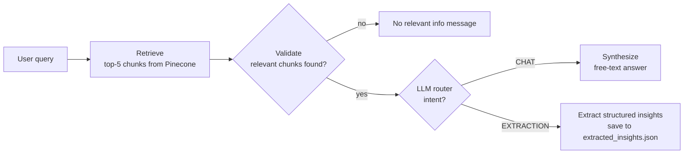

# Agentic RAG over Project Documentation

An agentic RAG (Retrieval-Augmented Generation) system that answers questions about a project's technical documentation and automatically decides **how** to answer: as a free-text explanation, or as a structured, source-referenced list of decisions, rules and warnings saved to JSON.

Built with **LlamaIndex Workflows**, **Cohere** (LLM + multilingual embeddings), **Pinecone** and a **Gradio** chat UI. Supports questions in Hebrew and English.

## How it works

The query flows through an event-driven LlamaIndex `Workflow`:



1. **Retrieve**: semantic search over the indexed docs (Cohere `embed-multilingual-v3.0`, Pinecone, `top_k=5`).
2. **Validate**: stops early with a clear message when nothing relevant is found, instead of letting the LLM guess.
3. **Route**: an LLM call (Cohere `command-r`) classifies the intent as `CHAT` or `EXTRACTION`.
4. **Chat path**: a response synthesizer writes a grounded free-text answer.
5. **Extraction path**: the LLM extracts items into a defined schema, the result is saved to `extracted_insights.json`, and a readable report grouped by category and priority is shown in the UI.

## Structured extraction schema

Defined with Pydantic in `schema.py`:

| Field | Description |
|---|---|
| `id` | Unique ID, e.g. `dec-001`, `rule-001`, `warn-001` |
| `category` | `decisions`, `rules` or `warnings` |
| `title` / `content` | Short title and description |
| `priority` | `High`, `Medium` or `Low` |
| `source` | Source file and section anchor |
| `observed_at` | ISO timestamp |

## Knowledge base

`agent_docs/` contains the sample documentation the system is indexed on: the spec, decisions and task list of a full-stack task management system (with RTL/Hebrew support), plus an external architecture review and UI plan.

## Repository structure

```
agent_docs/                  # Documentation used as the knowledge base
agentic-rag-project/
├── app.py                   # Workflow (retrieve → validate → route → chat/extract) + Gradio UI
├── ingest_data.py           # Loads .md docs, chunks them (512 tokens, overlap 50), indexes in Pinecone
├── schema.py                # Pydantic extraction schema
├── extracted_insights.json  # Example extraction output
└── workflow_graph.html      # Auto-generated visualization of the workflow
```

## Getting started

**Requirements:** Python 3.10+, a Cohere API key, a Pinecone API key and a Pinecone index named `agentic-docs-index`.

```bash
cd agentic-rag-project
python -m venv venv
venv\Scripts\activate          # Windows  (Linux/Mac: source venv/bin/activate)
pip install gradio python-dotenv pydantic pinecone llama-index llama-index-llms-cohere llama-index-embeddings-cohere llama-index-vector-stores-pinecone
```

Create a `.env` file in `agentic-rag-project/`:

```env
COHERE_API_KEY=your_cohere_key
PINECONE_API_KEY=your_pinecone_key
```

Index the documentation (first run only), then start the app:

```bash
python ingest_data.py
python app.py
```

Open the local link printed in the terminal (usually http://127.0.0.1:7860).

## Example questions

**Chat path**
- "What was decided about the frontend?"
- "Which technologies does the project use?"

**Extraction path**
- "List all technical decisions."
- "Summarize all the decisions, rules and warnings in the project."
